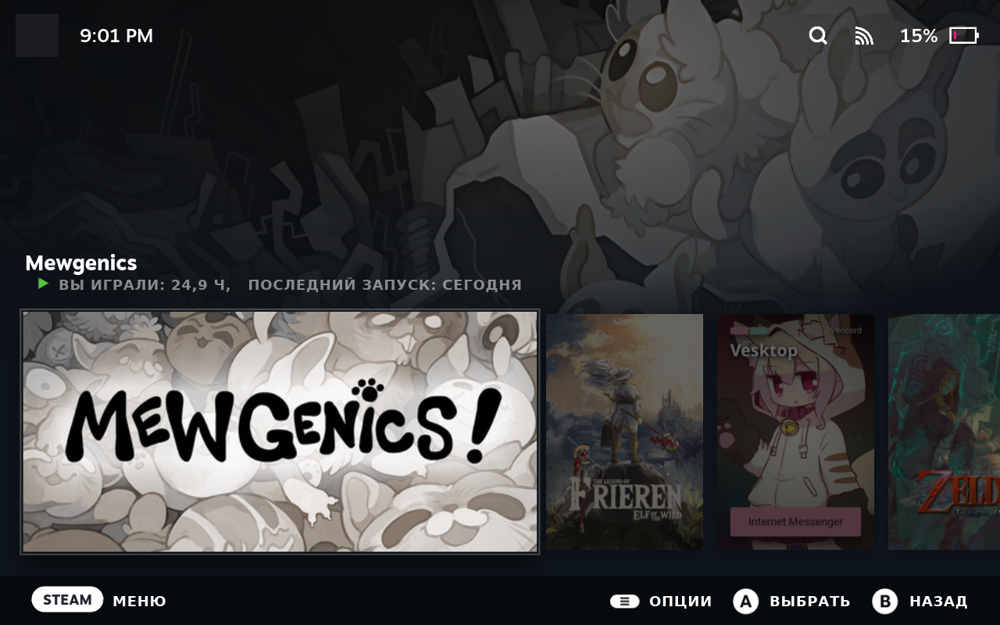
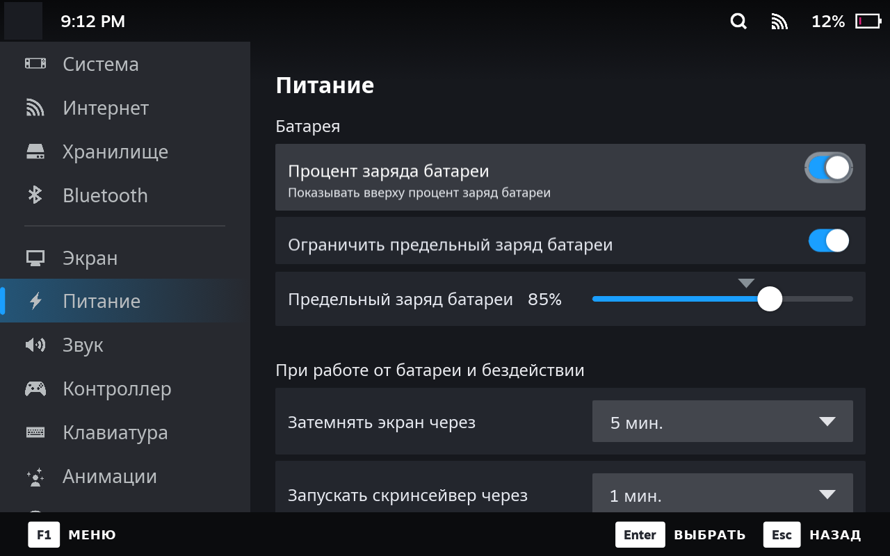
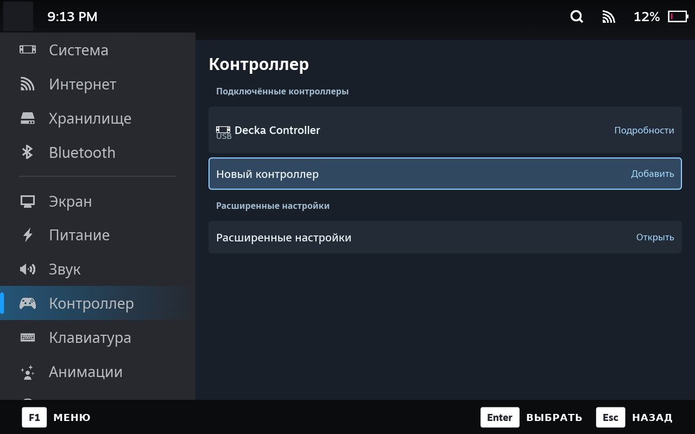
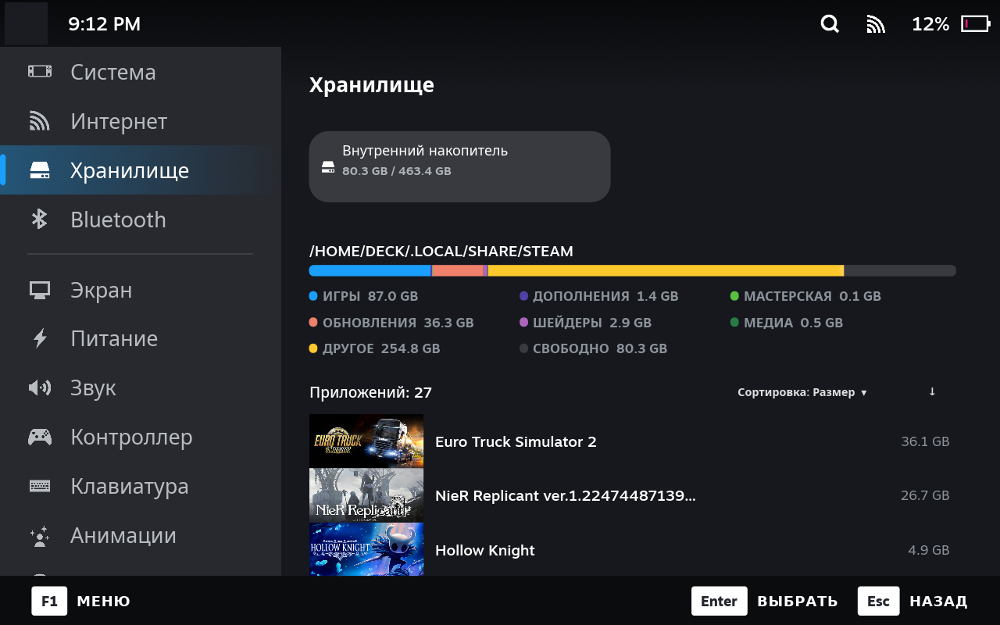

# DeckShell

> 🌐 **This README is bilingual: English first, Russian below · Этот README двуязычный: сначала English, ниже — [русская версия](#русская-версия).**

**An experimental, native (Rust + [Slint](https://slint.dev)) replacement for the Steam Deck Gaming Mode interface.**
Steam stays the backend — DeckShell only replaces what you see and touch in Gaming Mode: Home, Library, game pages,
the STEAM menu, the Quick Access Menu and the Settings pages. It is reversible, off by default, and has a kill switch.

<p align="center">
  
  
</p>
<p align="center">
  
  
</p>

> ⚠️ **This is an early, experimental project (v0.1.0, pre-release).** Large parts are incomplete, many places contain
> **stubs / placeholders**, and it has only been tested on one Steam Deck (LCD/OLED not distinguished, SteamOS 3.x stable,
> Russian UI language; English added in v0.1.1 and only lightly tested on a real Deck). Expect bugs. Read [Status](#status) and [Safety and recovery](#safety-and-recovery) before installing.

## Highlights — what already works (and works *much* better than in stock Steam)

*Based on the author's daily use on a real Deck; there is no formal benchmark yet (see [Why try it](#why-try-it-and-what-is-not-proven-yet)).*

- **Noticeably smoother than the stock Steam UI** in the parts that are implemented — navigation, Library, Settings and menus feel several times snappier on the author's Deck.
- **Built-in functionality of popular Decky plugins — no plugin loader needed:**
  - 🎞️ **Animation Changer** — native Animations page: browse and apply boot / suspend animations.
  - 🖼️ **SteamGridDB** — custom capsules, heroes, logos and icons straight from SteamGridDB. *You need your own free SteamGridDB API key* (create it on steamgriddb.com → Preferences → API, then put it into `~/.config/deckshell/sgdb.json` as `{"api_key": "YOUR_KEY"}`, or set `DECKSHELL_SGDB_KEY`; without a key only the offline cache works).
- **No lag with animated (video/WebM) SteamGridDB artwork** — animated capsules and heroes play smoothly instead of stuttering the whole UI.
- Reversible, off by default, one-command install and rollback.

## Languages — English and Russian built in, add yours with your AI agent 🌍

DeckShell picks its language **automatically from your Steam language**: Steam set to Russian → Russian, anything else → English. No setting needed
(override for testing: `DECKSHELL_LANG=en` / `ru`, or one line in `~/.config/deckshell/lang`).

Want your language? Ask your AI coding agent (Claude Code, Codex, Gemini CLI, …). Clone the repo, open the agent in it and paste:

```text
Add the language LANGUAGE to DeckShell (locale code CODE, Steam language name STEAM_NAME, e.g. german).
Read docs/LANGUAGES.md first. Copy locales/en.json to locales/CODE.json and translate every value
(keep the keys and the {placeholders}). Register the locale as described in the doc, run
DECKSHELL_DRYRUN=1 cargo test --workspace, and open a pull request. Do not touch anything else.
```

(Replace LANGUAGE, CODE and STEAM_NAME with your values.)

Details and the full prompt: [docs/LANGUAGES.md](docs/LANGUAGES.md). Translations are very welcome as pull requests.

## Install (one command)

On the Deck, in Desktop Mode (Konsole) or over SSH, as the normal `deck` user:

```bash
curl -fsSL https://github.com/Kit1112/DeckShell/releases/latest/download/install.sh | bash
```

This downloads the release, verifies its SHA-256, installs it into `~/.local/share/deckshell` and registers a
*user-level* systemd drop-in. **DeckShell is installed but OFF** — you keep the stock UI until you opt in:

```bash
echo hybrid > ~/.config/deckshell/mode      # DeckShell ON  (takes effect at the next Gaming Mode start / reboot)
echo stock  > ~/.config/deckshell/mode      # back to the stock Steam UI
```

Or install and enable in one go: `curl -fsSL …/install.sh | bash -s -- --enable`.
Prefer to read before you run? Download `install.sh` from the [release page](../../releases) and open it — it is ~80 lines, no sudo.

Requirements: Steam Deck on SteamOS 3.x with Gaming Mode, Steam client files in `~/.local/share/Steam`, internet for the download.
No root, nothing in `/usr`, the SteamOS image and the Steam client are **not modified**.

**Uninstall:** `curl -fsSL https://github.com/Kit1112/DeckShell/releases/latest/download/install.sh | bash -s -- --uninstall --purge`

## Safety and recovery

- Off by default (`mode = stock`); switching it on is your explicit choice.
- Emergency exit: hold **Volume-Down** (or **B**) for ~2 s while Gaming Mode starts, or create `~/.config/deckshell/disable` over SSH.
- Full rollback: `bash ~/.local/share/deckshell/session/rollback.sh` (works from Desktop Mode, SSH or a TTY). See [docs/ROLLBACK.md](docs/ROLLBACK.md).
- Known hazard: switching Gaming Mode sessions can occasionally leave gamescope without a DRM master (black/frozen screen).
  The project ships a guarded restart helper (`session/deck-session-restart.sh`) and a rebooting fixes it, but **have SSH or a keyboard handy the first time**.
- Keep a backup of anything you care about. **Use at your own risk — there is no warranty** (see [LICENSE](LICENSE)).

## Status

DeckShell is developed against a live Steam Deck, but many parts were verified only partially. "Works" below means *implemented and
seen working on the author's Deck*, not "bug-free". **Many screens contain stubs or simplified behaviour.**

### Works (implemented, checked on a real Deck at least partly)
- Home and Library (capsules, last played, art), game page, launching a game, installing a game through Steam's own install wizard
- STEAM menu (Home / Library / Downloads / Settings / Power) and keyboard/gamepad navigation, on-screen hints
- Quick Access Menu: performance controls (TDP slider with read-back, refresh/limits where Steam reports them), friends list (basic)
- Settings: **Internet / Wi-Fi**, **Storage**, **Bluetooth**, **Power** (battery %, charge limit, idle timers), **Controller** (device list, button/joystick binding editor, community layouts browser),
  Keyboard, and a native **Animations** page (boot/suspend animation browser — no Decky plugin needed)
- Downloads page, media/clips viewer, on-screen keyboard (with emoji), account chooser tiles
- Reversible install with stock fallback, kill switch and rollback scripts

### Partially working / unverified
- Account switching with **QR sign-in**, Steam Guard and password login — only exercised on a PC with mocks; **not** confirmed on a Deck
- HTTP proxy settings (Settings → Internet) — UI done, the exact Steam call format is unconfirmed
- Display, Sound and some other Settings pages — present, less tested
- Recording / clip capture integration, "send to phone", controller IMU/gyro wizard — implemented, lightly tested
- Languages: **Russian** (most tested) and **English** (v0.1.1: full UI coverage, checked by tests and on PC, less on a real Deck); other languages fall back to English until someone adds them (see above)

### Not implemented / known gaps
- Pixel-perfect parity with stock Steam: close in many screens, **not identical** (see [what we compare against](#how-it-is-built))
- L2/R2 mouse emulation, device-specific Library tabs, publishing/exporting controller layouts, deleting an account tile
- Selecting a friend opens the desktop chat instead of an inline chat
- Store, Community pages, Steam Input "Desktop" layouts editing beyond the basics, Desktop Mode (this is a Gaming Mode shell only)
- **Stubs and placeholders are present in many places** — if something looks real but does nothing, that's probably why. Please report it.

## Why try it (and what is *not* proven yet)

- **Native renderer instead of the Chromium-based Steam UI.** Rust + Slint (FemtoVG) draws the shell; the goal is lower overhead and snappier navigation.
  *Honest status:* one idle sample measured ≈15 % of a single core and ≈200 MB RSS; a controlled DeckShell-vs-stock comparison in real games is **planned but not done yet**
 . Do not treat "faster/lighter" as proven.
- **Built-in features that the stock UI lacks or gets from plugins:** native Animations page, local controller-glyph cache embedded in the package, HTTP proxy page, QR account chooser, richer controller-layout tools.
- **Hackable and open.** Everything is Rust/Slint/shell scripts you can read and change; the shell talks to Steam through its local debugging bridge instead of patching Steam.
- **Safe to try:** off by default, one-line rollback, stock UI one setting away.

## How it is built

- `app/` – the Slint UI and application logic (screens, navigation, input, hotkeys)
- `crates/` – Steam bridge (CDP), account/auth, data, assets, system integration (Wi-Fi, Bluetooth, power), media
- `session/` – Gaming Mode hook, install/uninstall/rollback, watchdog helpers
- `tools/gamescope/` – build and packaging, session-restart helper; `tools/perf/` – measurement tooling
- Build from source: you need Rust, Node.js and a **local Steam install** (DeckShell extracts UI assets/localization from your own Steam client at build time — they are not redistributed in source form here):

```bash
git clone https://github.com/Kit1112/DeckShell && cd DeckShell
DECKSHELL_STEAM=~/.local/share/Steam cargo build --release -p deckshell   # or tools/gamescope/build.sh for a SteamOS-compatible (glibc 2.34) binary
DECKSHELL_DRYRUN=1 cargo test --workspace                                 # tests (the env var is required)
```

## Legal, copyright and takedown

DeckShell is an independent, unofficial, non-commercial fan project made **only to improve the Steam Deck experience for users**.
It is **not affiliated with, endorsed by or sponsored by Valve Corporation**. *Steam*, *Steam Deck*, *SteamOS* and related names, logos and artwork are trademarks and/or
property of Valve Corporation and other rights holders; they are used here only to identify compatibility.

**We do not claim any rights to third-party material.** Because DeckShell reproduces the look and behaviour of the Steam UI, the repository and the release binary may contain
or embed Steam-derived assets (icons, controller glyphs, interface strings) and small third-party files (e.g. a cat GIF). If you are a rights holder and want any part — or the whole repository —
removed, please open an issue or contact the maintainer and **it will be removed promptly**. No Valve source code or Steam client binaries are included.

**License:** DeckShell's own code is under the [PolyForm Noncommercial License 1.0.0](LICENSE) (see also [NOTICE](NOTICE)).
In plain words: you may use, copy, modify, fork and share everything in this project, anywhere, for free — **but not to make money from it**.
This is a *source-available* license rather than an OSI "open source" one, precisely because of the no-commercial-use rule.
Third-party components keep their own licenses (see `Cargo.lock`). Note for redistributors: the UI toolkit Slint is offered under GPLv3, a royalty-free license and commercial terms;
check that your way of redistributing binaries complies with the Slint terms you choose. Provided "as is", without warranty of any kind.

## Contributing — AI-assisted help is very welcome 🤖

This project is built largely *with* AI coding agents, and **we warmly welcome contributions made with your own AI tools** (Claude Code, Codex, Gemini CLI, Cursor, …) as well as by hand.
Point your agent at [CONTRIBUTING.md](CONTRIBUTING.md) and [AGENTS.md](AGENTS.md) — they explain the layout, how to build/test safely and the rules (never auto-switch a real Deck's session, redact personal data, say what you actually verified).
Good first areas: stubs/placeholders (grep `stub`/`not implemented`), Display/Sound pages, other languages, performance measurements vs stock, packaging for other SteamOS versions.
Bug reports with Deck model, SteamOS version and `~/.local/state/deckshell/` logs (redact personal data) are very welcome too.

---

## Русская версия

> 🌐 README двуязычный: английская версия выше, русская ниже.

**DeckShell** — экспериментальная **нативная замена интерфейса Gaming Mode на Steam Deck** на Rust + [Slint](https://slint.dev).
Steam остаётся «движком»: подменяется только то, что вы видите и трогаете — главный экран, библиотека, страницы игр, меню STEAM, быстрое меню (QAM) и настройки.
Всё обратимо, по умолчанию выключено, есть аварийный выключатель.

> ⚠️ **Ранний экспериментальный проект (v0.1.0, пре-релиз).** Многое не доделано, **во многих местах заглушки**, проверялось на одной Деке (SteamOS 3.x, русский язык). Возможны баги. Прочитайте «Статус» и «Безопасность и откат» перед установкой.

### Главное — что уже работает (и работает *кратно* лучше, чем в самом Steam)

*По ежедневному опыту автора на настоящей Деке; формального бенчмарка пока нет (см. «Зачем пробовать»).*

- **Заметно плавнее штатного интерфейса Steam** в реализованных частях — навигация, библиотека, настройки и меню ощущаются в разы отзывчивее.
- **Встроенный функционал популярных плагинов Decky — загрузчик плагинов не нужен:**
  - 🎞️ **Animation Changer** — нативная страница «Анимации»: просмотр и применение анимаций загрузки/сна.
  - 🖼️ **SteamGridDB** — свои капсулы, обложки, логотипы и иконки прямо из SteamGridDB. *Нужен ваш собственный бесплатный API-ключ SteamGridDB* (создаётся на steamgriddb.com → Preferences → API, затем впишите его в `~/.config/deckshell/sgdb.json` как `{"api_key": "ВАШ_КЛЮЧ"}` или задайте `DECKSHELL_SGDB_KEY`; без ключа работает только офлайн-кэш).
- **Не лагает с анимированными (видео/WebM) элементами SteamGridDB** — анимированные капсулы и обложки играют плавно, не тормозя весь интерфейс.

### Языки — английский и русский встроены, свой язык можно добавить с ИИ-агентом 🌍

DeckShell выбирает язык **автоматически по языку вашего Steam**: Steam на русском → русский, любой другой → английский. Настраивать ничего не нужно
(для проверки: `DECKSHELL_LANG=en` / `ru` или одна строка в `~/.config/deckshell/lang`).

Нужен ваш язык? Попросите своего ИИ-агента (Claude Code, Codex, Gemini CLI и др.): склонируйте репозиторий, откройте в нём агента и вставьте этот промпт (подробности и русская сводка — в [docs/LANGUAGES.md](docs/LANGUAGES.md)):

```text
Добавь в DeckShell язык ЯЗЫК (код CODE, имя языка Steam STEAM_NAME, например german).
Сначала прочитай docs/LANGUAGES.md. Скопируй locales/en.json в locales/CODE.json и переведи
все значения (ключи и {плейсхолдеры} не менять). Зарегистрируй язык, как описано в документе,
прогони DECKSHELL_DRYRUN=1 cargo test --workspace и оформи pull request. Больше ничего не трогай.
```

Переводы — очень приветствуются.

### Установка (одной командой)

На Деке, в Desktop Mode (Konsole) или по SSH, от обычного пользователя `deck`:

```bash
curl -fsSL https://github.com/Kit1112/DeckShell/releases/latest/download/install.sh | bash
```

Скрипт скачивает релиз, проверяет SHA-256, ставит в `~/.local/share/deckshell` и регистрирует *пользовательский* systemd-drop-in. **DeckShell устанавливается, но ВЫКЛЮЧЕН** — остаётся штатный интерфейс, пока вы сами не включите:

```bash
echo hybrid > ~/.config/deckshell/mode      # ВКЛ  (с ближайшего запуска Gaming Mode / после перезагрузки)
echo stock  > ~/.config/deckshell/mode      # ВЫКЛ (обратно штатный интерфейс Steam)
```

Установить и сразу включить: `curl -fsSL …/install.sh | bash -s -- --enable`. Хотите сначала прочитать скрипт — он на ~80 строк, без sudo, лежит на [странице релиза](../../releases).
Нужно: Steam Deck с SteamOS 3.x, файлы клиента Steam в `~/.local/share/Steam`, интернет. Root не нужен, `/usr`, образ SteamOS и сам клиент Steam **не изменяются**.
**Удаление:** `curl -fsSL https://github.com/Kit1112/DeckShell/releases/latest/download/install.sh | bash -s -- --uninstall --purge`

### Безопасность и откат
- По умолчанию выключено (`mode = stock`); включение — ваш осознанный выбор.
- Аварийный выход: удерживайте **Volume-Down** (или **B**) ~2 с при запуске Gaming Mode, либо создайте `~/.config/deckshell/disable` по SSH.
- Полный откат: `bash ~/.local/share/deckshell/session/rollback.sh` (из Desktop Mode, SSH или TTY). См. [docs/ROLLBACK.md](docs/ROLLBACK.md).
- Известный риск: при смене сессии Gaming Mode иногда теряется DRM master (чёрный/замёрзший экран). Есть защищённый помощник `session/deck-session-restart.sh`, помогает перезагрузка, но **в первый раз держите под рукой SSH или клавиатуру**.
- Используйте на свой риск, **без гарантий**.

### Статус
«Работает» = *реализовано и видели работающим на Деке автора*, а не «без багов». **Во многих экранах заглушки и упрощённое поведение.**

**Работает (реализовано, хотя бы частично проверено на Деке):** главная и библиотека, страница игры и запуск, установка игры через штатный мастер Steam; меню STEAM и навигация геймпадом/клавиатурой; быстрое меню (производительность/TDP, друзья — базово); настройки: **Интернет/Wi-Fi, Хранилище, Bluetooth, Питание, Контроллер** (список устройств, редактор кнопок и джойстиков, браузер сообществ-раскладок), Клавиатура, нативная страница **«Анимации»** (без плагина Decky); страница загрузок, медиа/клипы, экранная клавиатура (с эмодзи), плитки выбора аккаунта; обратимая установка со стоковым фолбэком.

**Частично / не проверено:** смена аккаунта с **QR-входом**, Steam Guard и вход по паролю — проверено только на ПК на моках, на Деке не подтверждено; страница HTTP-прокси — интерфейс есть, точный вызов Steam не подтверждён; страницы «Экран», «Звук» и др. — есть, проверены слабее; запись/клипы, «отправить на телефон», мастер гироскопа — реализованы, проверены слабо; языки — **русский** (проверен больше всего) и **английский** (в v0.1.1 полное покрытие интерфейса, проверен тестами и на ПК, на настоящей Деке меньше); остальные языки пока дают английский.

**Не сделано / известные пробелы:** пиксель-в-пиксель совпадение со стоком (во многих экранах близко, но **не идентично**); эмуляция мыши на L2/R2, вкладки библиотеки для конкретных устройств, публикация/экспорт раскладок, удаление плитки аккаунта; выбор друга открывает чат десктопного Steam, а не встроенный; магазин, сообщество, Desktop Mode (это только оболочка Gaming Mode); **заглушки и плейсхолдеры есть во многих местах** — если что-то выглядит настоящим, но ничего не делает, скорее всего это оно. Сообщайте.

### Зачем пробовать (и что пока НЕ доказано)
- **Нативный рендер вместо интерфейса на Chromium.** Rust + Slint рисуют оболочку; цель — меньше накладных расходов и отзывчивее навигация. *Честно:* один замер в простое — ≈15 % одного ядра и ≈200 МБ RSS; контролируемое сравнение DeckShell и стока в реальных играх **запланировано, но не сделано**. «Быстрее/легче» как факт заявлять нельзя.
- **Встроенное то, чего нет в стоке или что ставится плагинами:** нативная страница анимаций, локальный кэш глифов контроллера внутри пакета, страница HTTP-прокси, выбор аккаунта по QR, расширенные инструменты раскладок контроллера.
- **Открыто и расширяемо:** Rust/Slint/shell-скрипты, которые можно читать и менять; оболочка общается со Steam через его локальный отладочный мост, а не патчит Steam.
- **Безопасно пробовать:** выключено по умолчанию, откат одной командой, штатный UI — одна настройка.

### Как устроено
`app/` — интерфейс Slint и логика; `crates/` — мост со Steam (CDP), аккаунты/авторизация, данные, ассеты, системная интеграция (Wi-Fi, Bluetooth, питание), медиа; `session/` — хук Gaming Mode, установка/удаление/откат; `tools/gamescope/` — сборка и упаковка; `tools/perf/` — инструменты замеров.
Сборка из исходников: нужны Rust, Node.js и **локальный Steam** (UI-ассеты и локализация извлекаются из вашего клиента во время сборки и в исходниках не распространяются):

```bash
git clone https://github.com/Kit1112/DeckShell && cd DeckShell
DECKSHELL_STEAM=~/.local/share/Steam cargo build --release -p deckshell   # или tools/gamescope/build.sh — бинарник под glibc 2.34 (SteamOS)
DECKSHELL_DRYRUN=1 cargo test --workspace                                 # тесты (переменная обязательна)
```

### Авторские права, лицензия и удаление
DeckShell — независимый неофициальный некоммерческий фан-проект, сделанный **только чтобы улучшить опыт пользователей Steam Deck**. **Не связан с Valve Corporation**, не одобрен и не спонсируется ею. *Steam*, *Steam Deck*, *SteamOS* и связанные названия, логотипы и графика принадлежат Valve и другим правообладателям и упоминаются только для указания совместимости.
**Мы не претендуем ни на чьи авторские права.** Поскольку DeckShell воспроизводит вид и поведение интерфейса Steam, репозиторий и бинарник могут содержать или встраивать производные от Steam ресурсы (иконки, глифы контроллера, строки интерфейса) и мелкие сторонние файлы. Если вы правообладатель и хотите убрать часть или весь репозиторий — откройте issue или свяжитесь с мейнтейнером, **мы оперативно удалим**. Исходного кода Valve и бинарников клиента Steam здесь нет.

**Лицензия:** собственный код DeckShell — [PolyForm Noncommercial 1.0.0](LICENSE) (см. также [NOTICE](NOTICE)). Простыми словами: **используйте, копируйте, изменяйте, форкайте и распространяйте всё что угодно и где угодно бесплатно — но не зарабатывайте на этом.** Это «source-available», а не OSI-«open source» лицензия — из-за запрета коммерческого использования. Сторонние компоненты сохраняют свои лицензии (см. `Cargo.lock`); UI-библиотека Slint предлагается под GPLv3, royalty-free и коммерческой лицензиями — при распространении бинарников проверьте соответствие выбранным условиям Slint. Предоставляется «как есть», без гарантий.

### Участие — помощь с вашими ИИ-агентами крайне приветствуется 🤖
Проект в основном делается *вместе* с ИИ-агентами, и мы **будем очень рады вкладу, сделанному вашими ИИ-инструментами** (Claude Code, Codex, Gemini CLI, Cursor и др.), как и ручному. Направьте агента на [CONTRIBUTING.md](CONTRIBUTING.md) и [AGENTS.md](AGENTS.md): там структура проекта, безопасная сборка и тесты, правила (не переключать сессию настоящей Деки автоматически, вычищать личные данные, честно писать, что реально проверено).
С чего начать: заглушки (ищите `stub` / `not implemented`), страницы «Экран» и «Звук», другие языки, замеры производительности против стока, упаковка под другие версии SteamOS. Баг-репорты (модель Деки, версия SteamOS, логи `~/.local/state/deckshell/` без личных данных) — тоже очень ценны.
